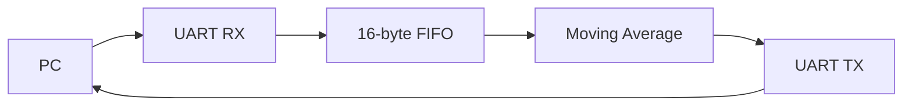

# FPGA - UART Moving Average Processor

A Verilog FPGA system that receives unsigned byte samples from a PC over UART, buffers them in a FIFO, calculates a four-sample moving average, and sends each result back to the PC. The design was simulated in Questa and tested on a Terasic DE23-Lite board against a Python reference model.

## Overview

- **Input:** One 8-bit unsigned sample, with values from 0 to 255.
- **Processing:** Calculate the integer average of the latest four accepted samples. Each new sample replaces the oldest sample. Fractional results are discarded.
- **Output:** One 8-bit moving-average result per sample.

The sample history starts at `[0, 0, 0, 0]`, so the system produces a result from the first sample. For example, sending `4, 8, 12, 16, 20` after reset produces `1, 3, 6, 10, 14`.

For another example, a list containing `[4, 2, 2, 4]` has an average of `3`. The leftmost entry is the newest sample, and accepting `5` changes the list to `[5, 4, 2, 2]`; the new integer average is `13 / 4 = 3`.

Pressing **KEY[0]** resets the sample history to four zeros.
## System Architecture


The UART receiver reconstructs each byte from an 8N1 frame and requests a FIFO write when the byte is valid. The FIFO stores accepted samples.

The controller waits for the transmitter to finish the previous result before reading the next sample from the FIFO. Because the FIFO has a registered read output, the controller coordinates the read and the moving-average input-valid signal so the calculator receives the newly read byte. Once the result is valid, the transmitter captures it and sends an 8N1 frame back to the PC.

The board's USB-to-UART bridge handles conversion between USB signals on the PC side and UART signals on the FPGA side.


## Hardware and Tools

| Item | Details |
|---|---|
| FPGA board | [Terasic DE23-Lite] |
| Clock frequency | [50MHz] |
| Design language | [Verilog] |
| FPGA software | [Quartus Prime Pro Edition 25.1.1] |
| Simulator | [Questa FPGA Starter Edition 2025.1] |
| PC software | [Python 3.12.1 & pyserial 3.5] |

## Design Behavior

| Feature | Behavior |
|---|---|
| UART settings | 115200 baud, 8 data bits, no parity, 1 stop bit (8N1) |
| Sample format | 8-bit unsigned integers (0–255) |
| FIFO | 16 entries × 8 bits; output holds the last read byte |
| Moving average | Average of the latest 4 samples |
| Startup history | Four zeros in the list of data |
| Rounding | Integer division by 4 |
| Reset | Press KEY[0]; clears FIFO pointers, processing history, UART control state, and set the latest 4 samples to be [0,0,0,0] |
| FIFO overflow | Incoming sample discarded when full unless a simultaneous accepted read frees space |

Reset does not erase the FIFO memory array. Clearing its pointers and size index is enough for next operation. 

## Repository Contents

The following filenames identify the main project files. 

| File | Purpose |
|---|---|
| `uart_tx.v` | UART transmitter |
| `uart_rx.v` | UART receiver |
| `fifo.v` | 16-byte FIFO |
| `moving_average.v` | Four-sample moving-average calculator |
| `uart_processing_top.v` | Whole system |
| `golden_top.v` | Board-level ports, reset logic, and system instantiation |
| `uart_tx_tb.v`, `uart_rx_tb.v` | UART block testbenches |
| `fifo_tb.v` | FIFO testbench |
| `moving_average_tb.v` | Moving-average testbench |
| `uart_processing_top_tb.v` | Whole system testbench |
| `simulate.do` | Reusable Questa simulation script for individual blocks |
| `uart_echo_test.py` | Python hardware test and reference-model comparison |
| `golden_top.qpf`, `golden_top.qsf`, `golden_top.sdc` | Quartus project, assignments, and timing constraints |
| `reset_release.ip` | FPGA initialization/reset-release IP configuration |

## Verification

### Simulation
Each block has a self-checking testbench. Detailed test sequences are documented in the testbench source files.

| Block | Test cases | Result |
|---|---|---|
| UART TX | Reset, frame sending, input changes during transmission | Passed |
| UART RX | Normal receive, reset, back-to-back receives, invalid stop bit, false start, recovery | Passed |
| FIFO | Reset, ordering, empty reads, disabled writes, full writes, pointer wraparound, simultaneous read/write | Passed |
| Moving average | Startup, valid start, sample replacement, truncation, reset, maximum sum, | Passed |
| Integrated system | RX-FIFO-processing-TX transfers, outgoing UART data, reset and restart | Passed |

### Hardware Testing

A Python script opens the board's COM port, sends samples, receives the results, and compares them with a software reference model. The reference uses a four samples `deque` initialized to zeros and calculates each expected result with `sum(history) // 4`.

The serial port remains open during a test run and closes when the script leaves its `with` block. Closing the port or rerunning Python does not reset the FPGA. Press and release **KEY[0]** before each run so the FPGA and Python reference start with the same sample history.

| Test | Result |
|---|---|
| Long sequence: send one sample and wait for its result before sending the next | Passed — all results matched the Python reference |
| Back-to-back sequence: send all samples together, then receive the results | Passed — all results matched the Python reference in order |

Hardware test script: [uart_echo_test.py]
Note:FIFO-full behavior was verified in the standalone FIFO simulation.
The hardware tests verified sequential and back-to-back transfers,
but did not deliberately force the FIFO to become full.
Overflow testing will be tested in the future.       
## How to Run

### Simulation

Open Questa and set the working directory to the folder containing
the Verilog files and `simulate.do`.

Run each individual testbench in the Transcript window:

```tcl
do simulate.do uart_tx uart_tx_tb
do simulate.do uart_rx uart_rx_tb
do simulate.do fifo fifo_tb
do simulate.do moving_average moving_average_tb
```

Run the whole system testbench:

```tcl
quit -sim
vlib work
vlog uart_tx.v uart_rx.v fifo.v moving_average.v uart_processing_top.v uart_processing_top_tb.v
vsim -voptargs=+acc work.uart_processing_top_tb
add wave -r sim:/uart_processing_top_tb/*
run -all
```

Skip `quit -sim` if no simulation is loaded. Check the Transcript
for failed checks and the final error count.

### FPGA Programming

1. Connect the DE23-Lite board to its power supply and connect its
   USB programming/UART port to the PC.
2. Open `golden_top.qpf` in Quartus Prime Pro Edition.
3. Select **Processing → Start Compilation**.
4. After compilation succeeds, open **Tools → Programmer**.
5. Select the board's USB-Blaster hardware in **Hardware Setup**.
6. Add `output_files/golden_top.sof` if it is not already listed.
7. Enable **Program/Configure** and click **Start**.
8. Wait for programming to reach 100%. The design starts automatically.

### Python Hardware Test

1. Connect and program the board using the steps above.
2. Install the serial communication dependency:

   ```powershell
   py -3.12 -m pip install pyserial
   ```

3. Find the board's COM port in Windows Device Manager under
   **Ports (COM & LPT)**. Update the Python script's port setting
   if necessary:

   ```python
   serial.Serial("COM5", baudrate=115200, timeout=2)
   ```

4. Close other programs using that COM port, such as PuTTY.
5. Press and release **KEY[0]** before each test run. This clears
   the FPGA's sample history so it matches the Python reference,
   which starts with four zeros.
6. From the folder containing the Python script, run:

   ```powershell
   py -3.12 .\uart_echo_test.py
   ```

7. Verify that the received results match the Python reference
   and that no timeout or mismatch is reported.

The FPGA retains its sample history between Python runs unless reset.

## Limitations
- **Finite buffering and no host flow control:** The FIFO can store up to 16 waiting samples. If it becomes full and data keeps coming in, the incoming sample is discarded. The current design does not tell the PC to pause. Therefore, a proposed improvement can be a control flag that lets the PC know to stop sending in data until the stall is resolved.
- **UART-limited throughput:** The rate that the calculations can be handled is limited by the data sending/transmitting rate. Because the calculator in the system only takes 1 clock cycle, it mostly waits for the data sending/transmitting process which take much longer.
- **Integer precision:** Samples and results are unsigned bytes. Fractional averages are truncated, and signed or wider samples are not supported.


## What I Learned

- UART 8N1 protocol and how to use FSM to implement the TX & RX.
- How to design a FIFO that can hold the data, and can handle simultaneous read/write.
- How to write self-testbenches for every small module and tasks in those testbenches that improve the clarity and efficiency of the testing.
- How to write a software reference model to test and compare the result with the hardware result.
- How to write TCL scripts that automate the simulation process.
- How to design and test for every edge cases for each module.

### Engineering Decisions and Tradeoffs
**One sample processed per completed transmission:** The controller waits for UART TX to finish transmitting before reading and processing the next sample. This prevents a new result from overwriting the old result that perhaps has not yet been accepted by TX. Although TX stores its input byte internally when transmission starts, keeping processing serialized makes the data flow easier to verify. The tradeoff is a few additional control cycles between output frames. A future version could process ahead and queue results in an output FIFO.

**No PC-side flow control:** This version uses a byte-in, byte-out interface to keep the Python test and FPGA control logic simple, but it cannot guarantee lossless operation if the output rate is slower than the input rate. Because the FIFO only handles temporary stalls, it can't sustain the long build up delay.

**Zero-filled startup history:** Initializing the data list to four zeros allows a result for every accepted sample without having to track 4 valid samples have arrived. However, the first three results include those initial zeros rather than averaging only the valid samples.
### Bugs Encountered and How I Fixed Them
**Synthesis error:** I initially assigned a default value to `data_valid` before the reset `if/else` in a block sensitive to `posedge clock` and `negedge reset_n`. The code behaved as intended in RTL simulation, but Quartus rejected the structure during synthesis. Moving all assignments into the reset or clocked branch mimiced the supported asynchronous-reset flip-flop pattern:

```verilog
reg data_valid;

always @(posedge clock or negedge reset_n) begin
    if (!reset_n)
        data_valid <= 1'b0;
    else
        data_valid <= safe_read_enable;
end
```

This taught me that valid simulation behavior does not guarantee that the code can be synthesized into the intended hardware.

**Missed valid pulse in the final testbench:** When writing the final test case for the whole system, my simulation kept running past the expected end time because it was waiting for rx_valid = 1. I assumed that rx_valid would go HIGH at the end of the stop-bit period, but it had already pulsed HIGH halfway through. Therefore, when I checked the signal after the sending-data task returned, the checker waited for a HIGH value that never came. I realized that the checking code could not run while the input-generating task was running in the same sequential process. Therefore, I used fork ... join to run the sending and checking processes concurrently.

